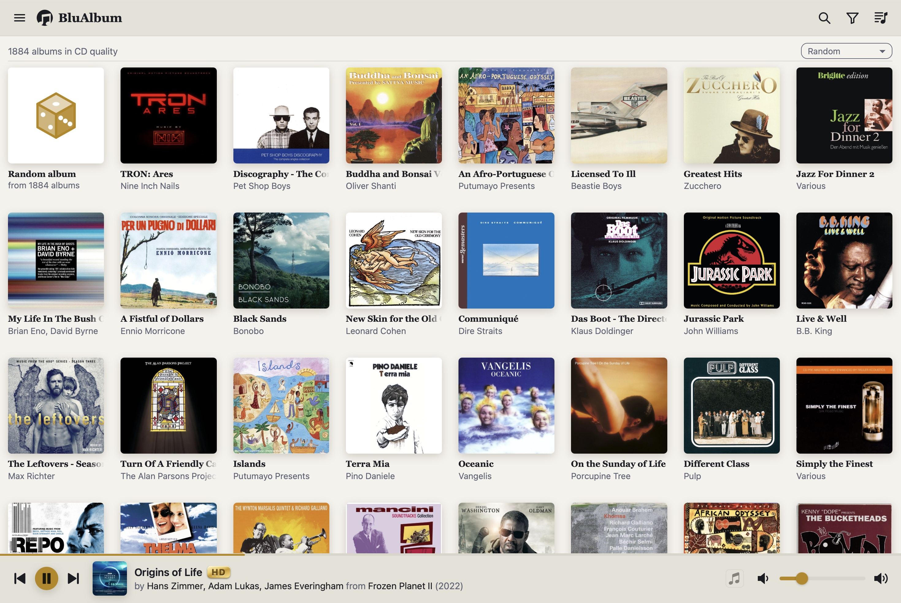

# <picture><source media="(prefers-color-scheme: dark)" srcset="docs/logo-dark.svg"></picture> BluAlbum

[](https://vibecoded.fyi/) [](https://github.com/ogig33/blu-album/actions/workflows/ui-tests.yml) [](https://github.com/ogig33/blu-album/actions/workflows/lint.yml) [](https://github.com/ogig33/blu-album/actions/workflows/format.yml) [](https://github.com/ogig33/blu-album/actions/workflows/github-code-scanning/codeql)

**Album player for BluOS devices.** A single HTML file that turns the local music library of a BluOS player (Bluesound, NAD) into an album wall: browse your albums by cover, search them, filter them, look at the details and play them, right from your browser.



## Features

- **Browse** your BluOS player's local music library (network share and USB drive), loaded lazily
- **Filter:** albums by All, Favourites, New, quality (HD, CD, MQA), decades, genres, playlists
- **Search:** for album titles, track artists, album artists, composers
- **Sort:** albums by album title, album artist, release year or randomly
- **Quick album actions:** play, add to the queue, mark as favourite
- **Random album:** play or add to queue for whole collection and any filter
- **Album details:** year, quality, format, bit depth, sample rate, average bitrate, artist per track, number of tracks, playing time, breakdown of multi-disc albums
- **Playlists:** BluOS and library playlists play, add to queue, list tracks 
- **Queue:** shuffle, repeat, reorder tracks by drag and drop, remove tracks, clear
- **Player bar:** play/pause, previous/next, seek, volume, show current player listening mode
- **Full-screen view:** focus on album art and current track; any album cover in full screen from its popup
- **Settings:** select music sources, enable filtering options, cover size, appearance

## Use it

1. Download the latest release
2. Open it in your browser. Phones and tablets cannot open a local HTML file: serve it from a web server in your home network, e.g. a NAS or `python3 -m http.server` on a computer, and open `http://<server>:<port>/blualbum.html`.
3. Enter the IP address of your player, e.g. `192.168.1.50`, and press **Connect**.
   You find the address in the BluOS Controller app under **Settings > Diagnostics**
   or in your router's device list.

BluAlbum talks to the player directly in your home network (`http://<player>:11000`).
Nothing is installed and no data leaves your network, except when you click
**Check for updates** in the about popup: then BluAlbum asks GitHub for the latest release.
Settings such as the last IP address and the design are kept in the browser's local storage.

## Requirements

- A BluOS player in your local network
- a local music library (network share and/or a USB drive) setup at your player with proper tagging: see the [library guidance](docs/blu-album-library-guidance.md)
- A current browser: Safari, Chrome, Edge or Firefox on a computer; Safari on iPhone and iPad

Tested with BluOS 4.18.18 on a Bluesound Powernode, and with Safari, Chrome, Microsoft Edge and Firefox on macOS, Windows and Linux (automated UI tests, see [Development](#development)); Safari on iPhone and iPad in the iOS Simulator (by hand).

## Development

Everything is in [`blualbum.html`](blualbum.html): CSS, HTML and plain JavaScript, no build
step and no dependencies. The script is split into modules, listed at its top.

Tests:
- [`tests/ui`](tests/ui) – Playwright tests of the user interface in Chrome, Safari (WebKit), Edge and Firefox against a mock player that answers with recorded (and sanitized) player responses. No player needed. Locally `npm test` runs 50 core tests; GitHub Actions runs all of them on macOS, Windows and Linux at three window sizes.
- [`tests/api`](tests/api) – contract tests of the BluOS API against a real player (Node.js only, no packages); they record the player answers the UI tests use. Run only on your own player: the write tests interrupt playback (and restore everything), the manual ones (reboot, rescan, firmware upgrade …) run only on request.

Checks on GitHub (`.github/workflows`, configs in `.github/lint`):
- `ui-tests.yml` – the UI tests, see [`tests/ui`](tests/ui/README.md#github-actions).
- `lint.yml` – ESLint (recommended rules) for the script in `blualbum.html`, `tests/ui` and `tests/api`.
- `format.yml` – Prettier (`printWidth` 120) for the test scripts `tests/**/*.js`; `blualbum.html` keeps its compact style. Push / PR only check; run by hand with input `fix` to format, commit and start UI tests and lint for that commit.

Lint and format locally (optional; installs into `.github/lint/node_modules`, git-ignored, the versions of the workflows):

```
npm install --prefix .github/lint --no-save --no-package-lock prettier@3.10.1 eslint@10.15.0 @eslint/js@10.0.1 eslint-plugin-html@8.2.1 globals@17.14.0
.github/lint/node_modules/.bin/eslint --config .github/lint/eslint.config.mjs blualbum.html tests/ui tests/api
.github/lint/node_modules/.bin/prettier --config .github/lint/prettier.json --check "tests/**/*.js"
```

## License

[MIT](LICENSE) © 2026 Ingmar Gebert
