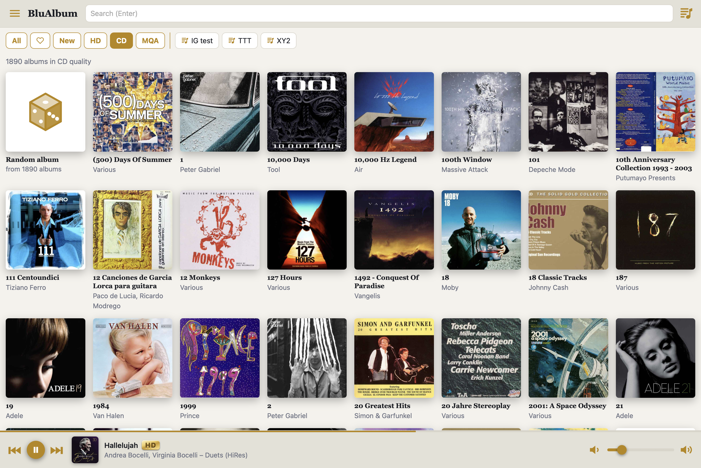

# BluAlbum

    

**Album player for BluOS devices.** A single HTML file that turns the local music library of a BluOS player (Bluesound, NAD) into an album wall: browse your albums by cover, search them, filter them, look at the details and play them, right from your browser.

## Features

- **Album wall** supports player's local music library (network share and USB drive), loaded lazily
- **Filters:** All, Favourites, New, quality (HD, CD, MQA), decades, genres, playlists
- **Search:** search for album titles, track artists, album artists, composers
- **Quick album actions:** play, add to the queue, mark as favourite
- **Play Random album:** available for whole collection and any filter, play or add to queue
- **Album details:** year, quality, format, bit depth, sample rate, average bitrate, artist per track, number of tracks, playing time, breakdown of multi-disc albums
- **BluOS Playlists:** play, add to queue, track list, create/delete
- **Library Playlists:** play, add to queue, track list, mark as favourites
- **Queue panel** shuffle, repeat, reorder tracks by drag and drop, remove tracks, clear
- **Player bar:** play/pause, previous/next, seek, volume, show current player listening mode
- **Full-screen view:** focus on album art and current track
- **Settings:** select music sources, enable filtering options, cover size, appearance

## Use it

1. Download the latest release
2. Open it in your browser. 
3. Enter the IP address of your player, e.g. `192.168.1.50`, and press **Connect**.
   You find the address in the BluOS Controller app under **Settings > Diagnostics**
   or in your router's device list.

BluAlbum talks to the player directly in your home network (`http://<player>:11000`).
Nothing is installed and no data leaves your network, except when you click
**Check for updates** in the about popup: then BluAlbum asks GitHub for the latest release.
Settings such as the last IP address and the design are kept in the browser's local storage.

## Requirements

- A BluOS player in your local network
- a local music library (network share and/or a USB drive) setup at your player with proper tagging: see the [library guidance](docs/blu-album-library-guidance.md)
- A current browser

Tested with BluOS 4.18.18 on a Bluesound Powernode, and with Safari, Chrome, Microsoft Edge and Firefox on macOS, Windows and Linux (automated UI tests, see [Development](#development)).

## Development

Everything is in [`blualbum.html`](blualbum.html): CSS, HTML and plain JavaScript, no build
step and no dependencies. The script is split into modules, listed at its top.

Tests:
- [`tests/api`](tests/api) – [Bruno](https://www.usebruno.com/) collection with contract tests
  for every player request the app uses (read-only and write tests) and exploration requests.
- [`tests/ui`](tests/ui) – Playwright tests of the user interface in Chrome, Safari (WebKit), Edge and Firefox against a mock player that answers with recorded (and sanitized) player responses. No player needed. Locally `npm test` runs 50 core tests; GitHub Actions runs all of them on macOS, Windows and Linux at three window sizes.
- [`tests/tools/sanitize-fixtures.js`](tests/tools/sanitize-fixtures.js) – copies recorded
  answers to the UI tests and removes personal details.
- [`tests/tools/crawl-endpoints.js`](tests/tools/crawl-endpoints.js) – walks the player's answers read-only (`node tests/tools/crawl-endpoints.js <player IP>`) and lists endpoints, parameters and answer fields that `docs/bluos-api.md` does not describe yet; the full result goes to `tests/api/fixtures/crawl-endpoints.json`.

Checks on GitHub (`.github/workflows`, configs in `.github/lint`):
- `ui-tests.yml` – the UI tests, see [`tests/ui`](tests/ui/README.md#github-actions).
- `lint.yml` – ESLint (recommended rules) for the script in `blualbum.html`, `tests/ui` and `tests/tools`.
- `format.yml` – Prettier (`printWidth` 120) for the test scripts `tests/**/*.js`; `blualbum.html` keeps its compact style. Push / PR only check; run by hand with input `fix` to format, commit and start UI tests and lint for that commit.

See [`CHANGELOG.md`](CHANGELOG.md) for the version history.

## License

[MIT](LICENSE) © 2026 Ingmar Gebert
